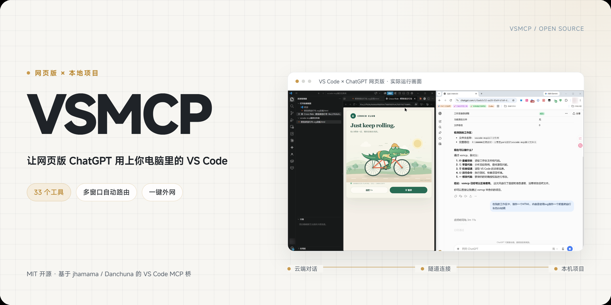
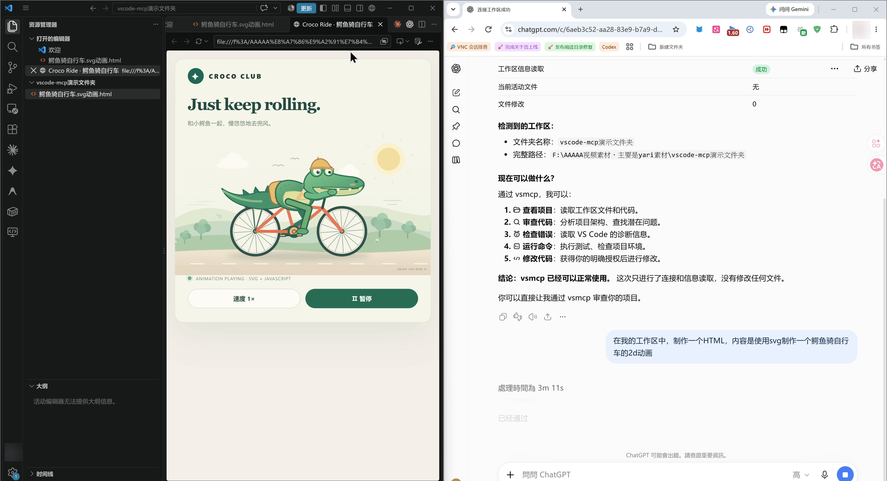
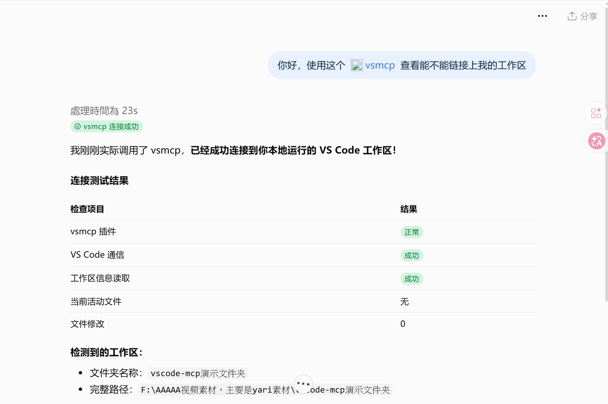
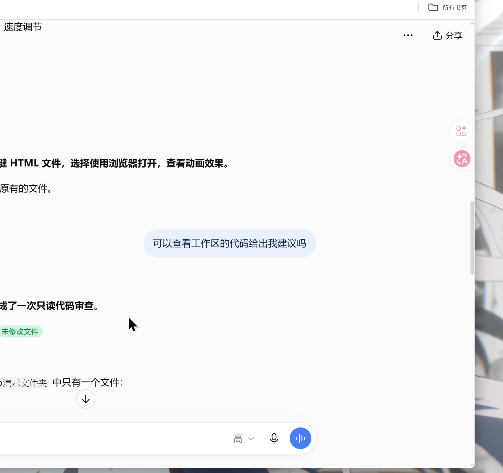
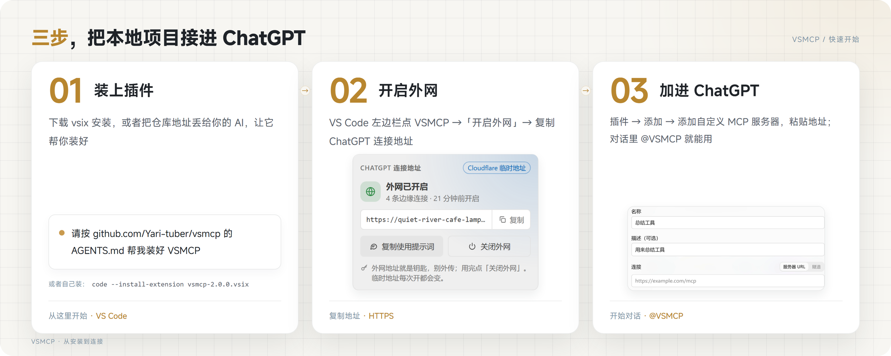
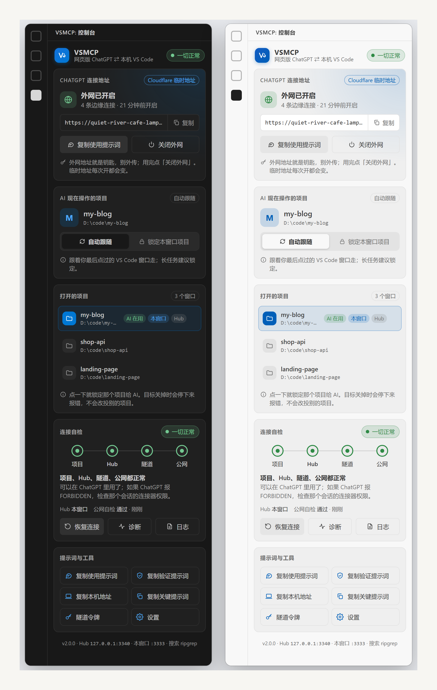
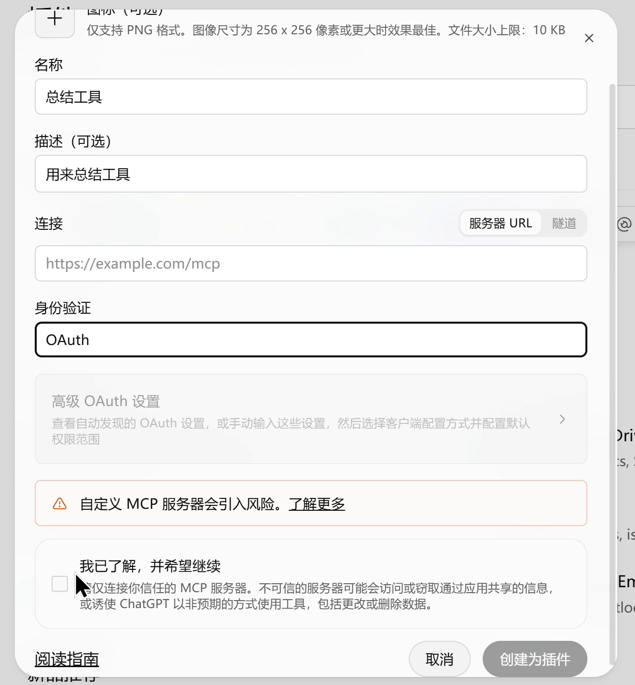
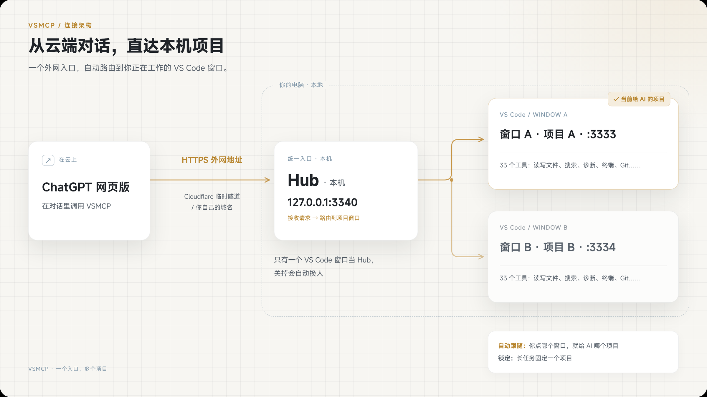

<p align="center">
  
</p>

<p align="center">
  <a href="https://github.com/Yari-tuber/vsmcp/releases/latest"></a>
  
  <a href="LICENSE"></a>
</p>

[简体中文](README.md) · **English** · [Agent install guide](AGENTS.md)

**VSMCP is a VS Code extension.** Once installed, it lets ChatGPT on the web—or any AI client that supports MCP—read, edit, and run the project open in VS Code on your computer through a public URL. Review code, change files, build a web page, or run tests, all from your chat.

- **Public access in one click:** choose “开启外网” (Enable public access) in the sidebar. VSMCP creates an HTTPS URL through a Cloudflare tunnel; paste it into ChatGPT to connect.
- **33 tools:** read and write files, search text, find files, browse directory trees, read multiple files, inspect diagnostics, go to definitions, rename symbols, use terminals, inspect Git, and more.
- **Multiple projects, one URL:** open several VS Code windows and automatically follow the one you last focused, or lock a project for a long task.
- **Automatic recovery:** disconnected tunnels restart automatically. The sidebar shows four layers of connection status: project, Hub, tunnel, and public endpoint.

> Treat the public URL like a key. VSMCP has no password by default: anyone with the URL can operate on your open project. Keep it private, and choose “关闭外网” (Disable public access) when you are done.

## What can it do?

Ask ChatGPT on the web to “make an animation of a crocodile riding a bicycle in my workspace,” and the files appear in VS Code on your computer:

<p align="center"></p>

<table>
  <tr>
    <td width="50%"></td>
    <td width="50%"></td>
  </tr>
  <tr>
    <td align="center">Check the connection: it can read your workspace</td>
    <td align="center">Ask for a code review: read-only, with no file changes</td>
  </tr>
</table>

## Get started in three steps

<p align="center"></p>

### 1. Install the extension

**The easiest way: ask your AI agent.** Send this to an agent that can operate your computer, such as Claude Code, Codex, or Cursor:

```
Follow AGENTS.md in https://github.com/Yari-tuber/vsmcp to install VSMCP for me, then give me the public URL.
```

**To install it yourself:**

1. Download `vsmcp-x.y.z.vsix` from [Releases](https://github.com/Yari-tuber/vsmcp/releases/latest).
2. In VS Code, open **Extensions** → **…** in the upper right → **Install from VSIX…**, then select the downloaded file. Or use a terminal:
   ```bash
   code --install-extension vsmcp-2.0.0.vsix
   ```
3. Public access requires `cloudflared`. If it is missing when you first choose “开启外网” (Enable public access), VSMCP offers to install it with winget. You can also install it beforehand:
   ```bash
   # Windows
   winget install --id Cloudflare.cloudflared
   # macOS
   brew install cloudflared
   ```

> If you previously installed `jhamama.vscode-mcp-api` (VS Code MCP Bridge) or another MCP bridge extension, uninstall it first to avoid port conflicts.

### 2. Enable public access and copy the URL

Click the **VSMCP** icon in VS Code's Activity Bar to open the control panel:

<p align="center"></p>

1. Choose **开启外网** (Enable public access), then wait a few seconds for **外网已开启** (Public access enabled).
2. Choose **复制** (Copy) next to the URL. It looks like `https://xxxx.trycloudflare.com/mcp`.

### 3. Add it to ChatGPT

1. Open ChatGPT on the web → **Plugins** in the left sidebar → **Add** in the upper right → **Add custom MCP server** (wording may vary).
2. Enter a name, such as `VSMCP`. Under **Connection**, choose **Server URL** and paste the URL you copied. Under **Authentication**, choose **No authentication** (wording may vary).
3. Check **“I understand and want to continue”** → **“Create as plugin”** (wording may vary). The plugin will list 33 tools.
4. Start a new conversation, type `@` in the message box, select the plugin you just created, and describe what you want to do.

<p align="center"></p>

For your first request, try this (the panel's “复制使用提示词” / Copy usage prompt button provides a fuller version):

```
First call workspace_overview and tell me which project is open and where its root directory is. Confirm that before reading or writing files as I request.
```

> Whether you can add a custom MCP server depends on your ChatGPT account and plan. If the button is missing, the feature is not available for your account yet. Other AI clients that support MCP—Claude, Cursor, Codex, and others—can use the same URL. For a client running on your computer, you can use `http://127.0.0.1:3340/mcp` directly without enabling public access.

## Working with multiple projects

<p align="center"></p>

- Each VS Code window runs its own MCP server, starting at port 3333, with up to five windows.
- One window acts as the **Hub** at `127.0.0.1:3340`. The public tunnel connects to it. If that window closes, another takes over within a few seconds.
- **Auto-follow** (the default): AI requests go to the project in the VS Code window you last focused.
- **Lock:** for a long task, choose “锁定本窗口项目” (Lock this window's project). Focusing other windows will no longer change the target.
- If the target project closes, the AI receives a clear error and **requests are never redirected to another project**. If the same folder is open in two windows, VSMCP refuses to guess which one to use.
- After switching projects, ask the AI to call `workspace_overview` again. The enhanced tools reject paths from the previous project.

## 33 tools

| Category | Tools |
|---|---|
| Explore the project | `workspace_overview` project summary · `list_directory` directory tree · `find_files` file search · `search_text` full-text search · `read_files` read multiple files · `git_inspect` Git status, diffs, and commits |
| Editor | `get_workspace_info` · `get_active_file` · `get_selection` · `get_open_tabs` · `open_file` · `close_file` · `get_diagnostics` |
| Read and write files | `read_file` · `write_file` · `create_file` · `delete_file` · `show_diff` |
| Understand code | `go_to_definition` · `find_references` · `get_hover` · `get_document_symbols` · `search_workspace_symbols` · `get_code_actions` · `apply_code_action` · `rename_symbol` |
| Terminal | `run_terminal_command` · `spawn_terminal` · `list_terminals` · `read_terminal` · `write_terminal` · `kill_terminal` |
| VS Code commands | `execute_vscode_command` |

Terminal tools use PowerShell on Windows, with readable Chinese output, and bash on macOS and Linux. `run_terminal_command` waits up to two minutes by default; pass `timeoutMs` for longer commands, up to one hour. For a persistent service, start it with `spawn_terminal`, inspect its output with `read_terminal`, and stop it and its child processes with `kill_terminal`.

Read-only tools carry `readOnlyHint`, so ChatGPT can call them without asking for confirmation each time. Tools that delete files or run commands are marked as destructive, so ChatGPT asks first. The enhanced tools use VS Code's bundled ripgrep, with no separate installation required. They skip `node_modules`, `.git`, build output, and common credential files such as `.env` and private keys.

## Want a fixed URL? (Optional)

A temporary tunnel gets a new URL every time it starts, so you need to update it in ChatGPT. For a fixed URL, choose one of these options:

| Option | Setup | URL |
|---|---|---|
| Cloudflare token tunnel | Create a tunnel in the Cloudflare dashboard and get its token → run “VSMCP：设置隧道令牌” (Set Tunnel Token) from the Command Palette → set `vsmcp.tunnelHostname` | `https://your-domain/mcp` |
| Cloudflare named tunnel | Run `cloudflared tunnel login / create / route dns` locally → set `vsmcp.tunnelName` and `vsmcp.tunnelHostname` | `https://your-domain/mcp` |
| localtunnel | Set `vsmcp.tunnelProvider` to `localtunnel`, optionally with `vsmcp.tunnelSubdomain` | `https://subdomain.loca.lt/mcp` |

The token is a sensitive credential. VSMCP stores it in the OS credential store, not in `settings.json`.

## Settings

| Setting | Default | Description |
|---|---|---|
| `vsmcp.autoStartTunnel` | `false` | Enable public access when VS Code starts |
| `vsmcp.autoRecover` | `true` | Rebuild the tunnel after 60 seconds offline, with retry intervals starting at 120 seconds and capped at 600 seconds |
| `vsmcp.authToken` | Empty | Optional Bearer token; empty means no authentication (ChatGPT on the web cannot set custom request headers) |
| `vsmcp.allowedCommands` | `[]` | Allowed commands for `execute_vscode_command`; empty means unrestricted |
| `vsmcp.commandTimeoutMs` | `120000` | Default timeout for `run_terminal_command` |
| `vsmcp.port` / `vsmcp.hubPort` | `3333` / `3340` | Starting window port / Hub port |
| `vsmcp.tunnelProvider` | `cloudflare` | `cloudflare` or `localtunnel` |
| `vsmcp.terminalStrategy` | `childProcess` | How terminal commands are executed |

## FAQ

**ChatGPT cannot connect, or a tool returns an error?** Check which of the panel's four connection indicators is not green. Open a project if none is open; choose “恢复连接” (Recover connection) if the tunnel is down. If all four are green but ChatGPT reports FORBIDDEN, that conversation lacks plugin permission. Start a new conversation and select the plugin with `@` again.

**The URL changed?** Restarting a temporary tunnel, or moving the Hub to another window, changes the URL. The panel will notify you. Update the URL in ChatGPT's plugin details, or use a fixed URL as described above.

**A port is busy?** Change `vsmcp.port` and `vsmcp.hubPort`, keeping the two port ranges separate.

**Is it safe?** Local servers listen only on `127.0.0.1`; public access goes through the tunnel URL. There is no password by default so ChatGPT on the web can connect directly. Keep the URL private and disable public access when you finish. ChatGPT asks for confirmation before running terminal commands or deleting files. For tighter control, configure `vsmcp.authToken` (for clients that can set request headers) or `vsmcp.allowedCommands`.

## Acknowledgments

VSMCP builds on two open-source projects, both licensed under MIT:

- [jhamama/vscode-mcp-bridge](https://github.com/jhamama/vscode-mcp-bridge): the original VS Code ↔ MCP bridge, providing the upstream tools and VS Code integration.
- [Danchuna/vscode-mcp-api](https://github.com/Danchuna/vscode-mcp-api): Chinese localization and public tunnels through Cloudflare and localtunnel. VSMCP started from its v1.0.1 source and preserves the full commit history.

VSMCP adds multi-window Hub routing with auto-follow and locking, six enhanced tools, a new sidebar control panel, automatic recovery with layered connection checks, and tool annotations for read-only and destructive operations.

## License

[MIT](LICENSE).
