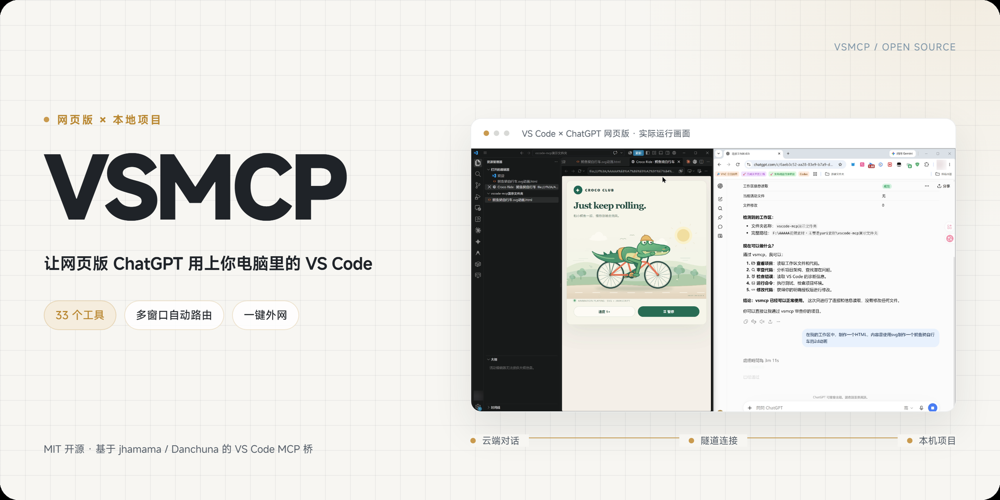
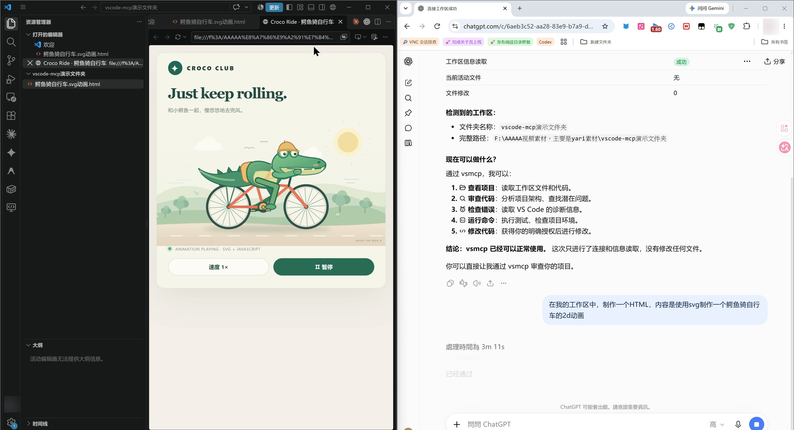
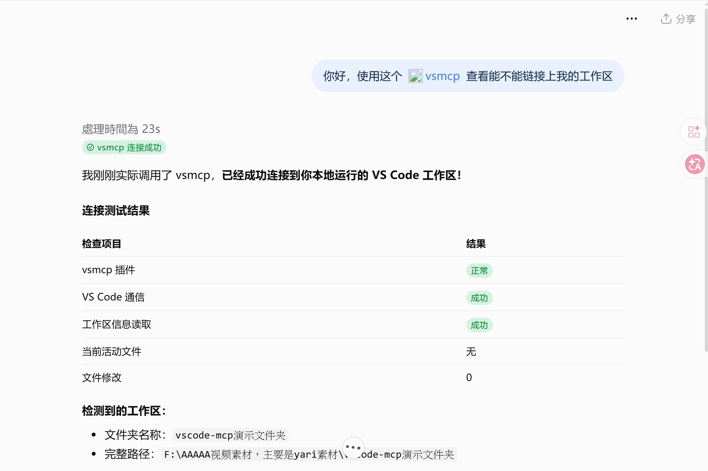
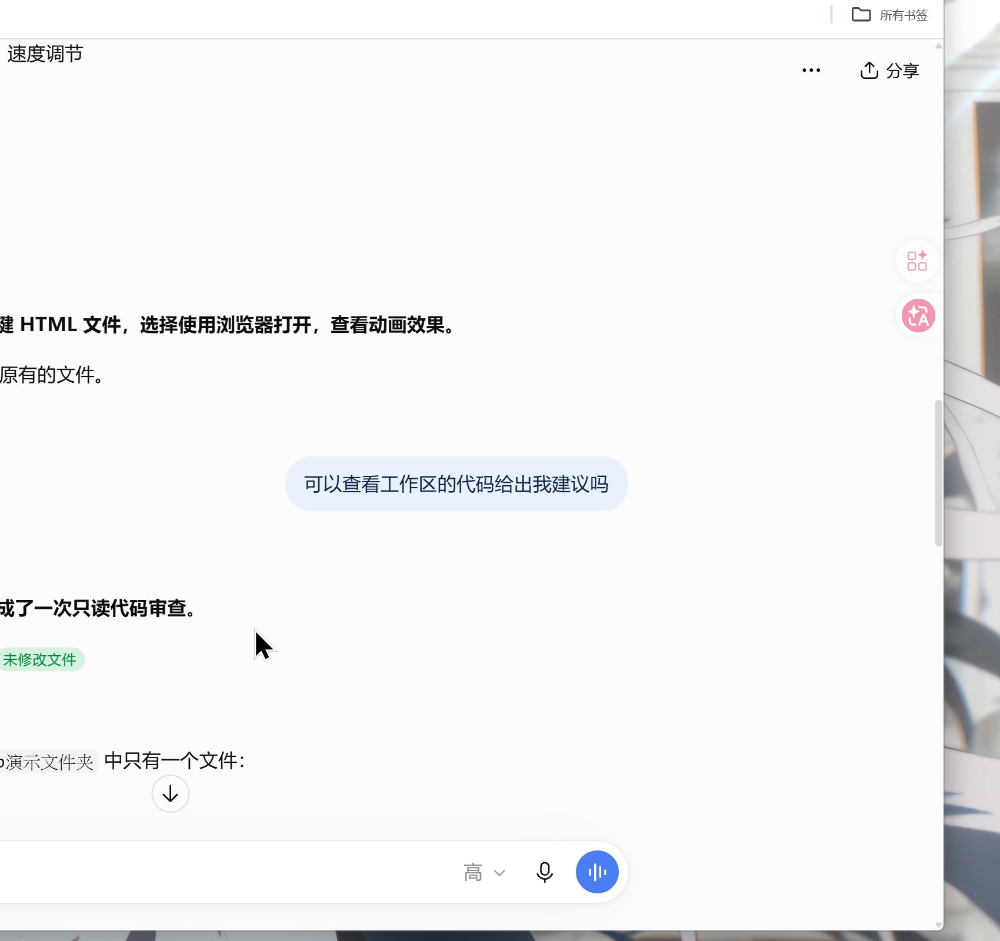
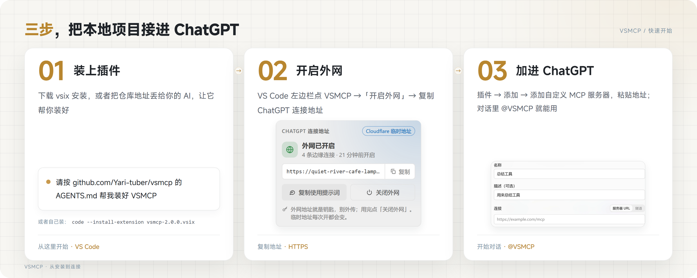
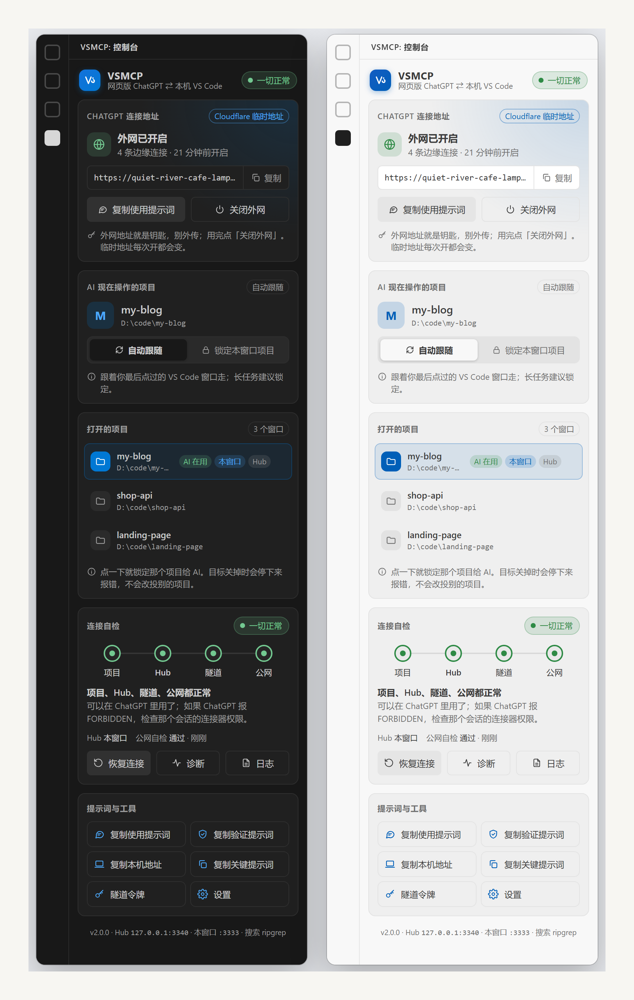
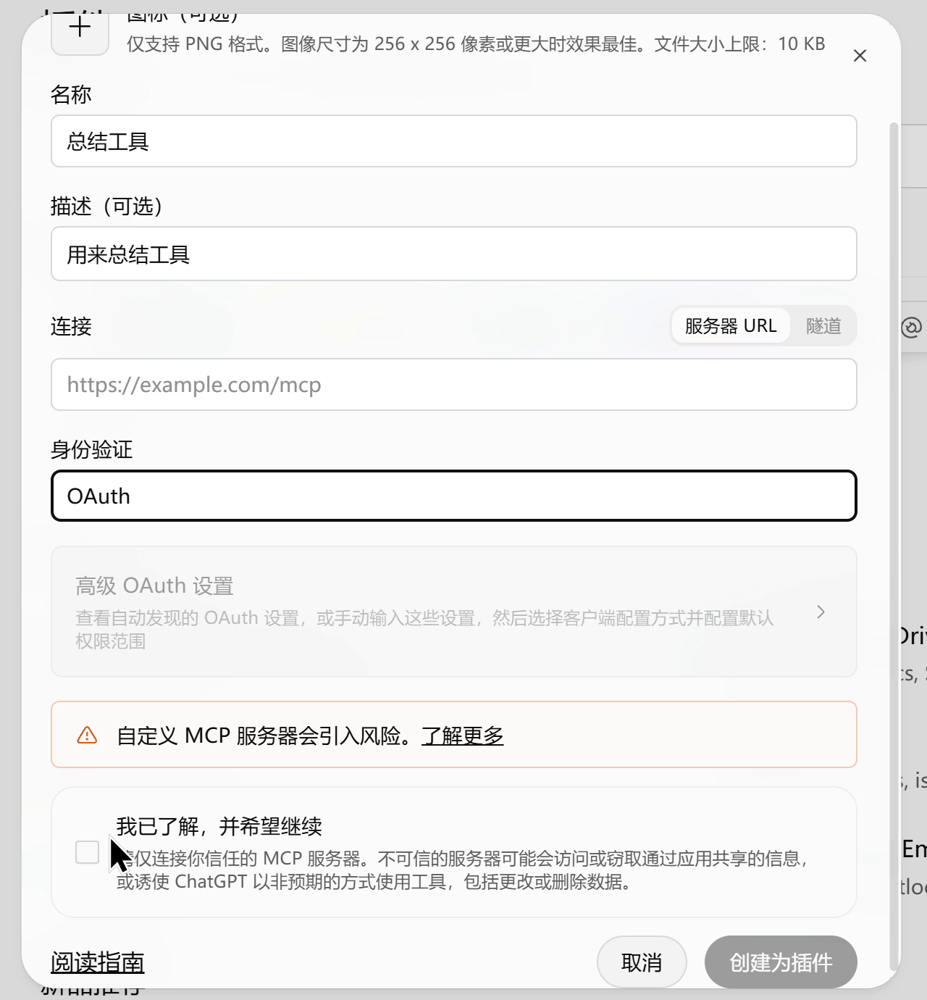
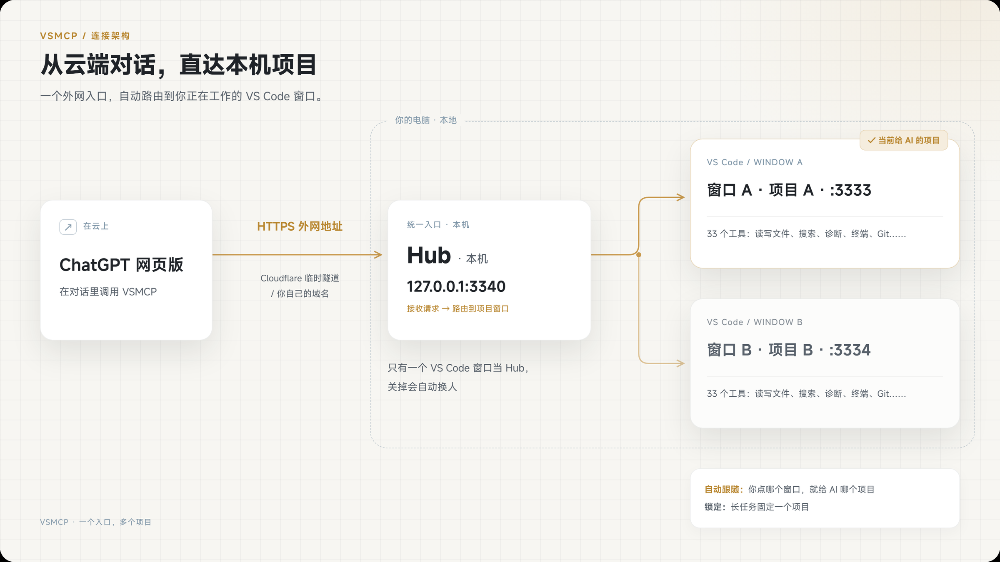

<p align="center">
  
</p>

<p align="center">
  <a href="https://github.com/Yari-tuber/vsmcp/releases/latest"></a>
  
  <a href="LICENSE"></a>
</p>

<p align="center"><strong>简体中文</strong> · <a href="README.en.md">English</a> · <a href="AGENTS.md">给 AI 的安装说明</a></p>

**VSMCP 是一个 VS Code 插件。** 装上以后，网页版 ChatGPT（或者任何支持 MCP 的 AI）就能通过一个外网地址，读、改、运行你电脑上 VS Code 打开的项目：看代码、改文件、新建网页、跑测试，全在网页聊天里完成。

- **一键外网**：侧栏点「开启外网」，自动用 Cloudflare 隧道给你的电脑开一个 HTTPS 地址，复制给 ChatGPT 就能用。
- **33 个工具**：读写文件、全文搜索、找文件、目录树、批量读取、代码诊断、跳转定义、重命名、终端、Git 查看……
- **多个项目也不乱**：开几个 VS Code 窗口都行，一个外网地址，自动跟随你最后点的窗口，长任务可以锁定一个项目。
- **断线自己恢复**：外网掉了自动重建，侧栏随时看「项目 / Hub / 隧道 / 公网」四层状态。

> 外网地址就是钥匙：VSMCP 默认不设密码，谁拿到地址谁就能操作你打开的项目。别外传，用完点「关闭外网」。

## 它能做什么

在网页版 ChatGPT 里说一句「在我的工作区里做一个鳄鱼骑自行车的动画」，左边 VS Code 里文件就自己出来了：

<p align="center"></p>

<table>
  <tr>
    <td width="50%"></td>
    <td width="50%"></td>
  </tr>
  <tr>
    <td align="center">先问能不能连上：它读到了你的工作区</td>
    <td align="center">让它看代码给建议：只读，不改文件</td>
  </tr>
</table>

## 三步开始

<p align="center"></p>

### 1. 装上插件

**最省事：交给你的 AI。** 在 Claude Code、Codex、Cursor 之类能操作电脑的 AI 里发一句：

```
请按 https://github.com/Yari-tuber/vsmcp 仓库里 AGENTS.md 的步骤，帮我装好 VSMCP，并把外网地址告诉我。
```

**自己装：**

1. 到 [Releases](https://github.com/Yari-tuber/vsmcp/releases/latest) 下载 `vsmcp-x.y.z.vsix`。
2. VS Code 左边「扩展」→ 右上角「…」→「从 VSIX 安装…」，选刚下载的文件。也可以在终端里：
   ```bash
   code --install-extension vsmcp-2.0.0.vsix
   ```
3. 外网要用 `cloudflared`。第一次点「开启外网」时没装会弹提示，一键用 winget 装好；也可以先装：
   ```bash
   # Windows
   winget install --id Cloudflare.cloudflared
   # macOS
   brew install cloudflared
   ```

> 以前装过 `jhamama.vscode-mcp-api`（VS Code MCP 桥接）或别的 MCP 桥接插件，先卸载，免得抢同一组端口。

### 2. 开启外网，复制地址

VS Code 左边活动栏点 **VSMCP** 图标，打开控制台：

<p align="center"></p>

1. 点 **开启外网**，等几秒，状态变成「外网已开启」。
2. 点地址旁边的 **复制**，拿到形如 `https://xxxx.trycloudflare.com/mcp` 的地址。

### 3. 加进 ChatGPT

1. 打开网页版 ChatGPT → 左边栏 **插件** → 右上角 **添加** → **添加自定义 MCP 服务器**。
2. 名称随便写（比如 `VSMCP`），**连接**选「服务器 URL」，粘贴刚才的地址；**身份验证**选「无身份验证 / No authentication」（以界面上的实际文字为准）。
3. 勾上「我已了解，并希望继续」→ **创建为插件**，它会列出 33 个工具。
4. 新开一个对话，输入框里打 `@`，选中你刚建的插件，再说你想干什么。

<p align="center"></p>

第一次用，建议先发一句（控制台「复制使用提示词」也能拿到完整版）：

```
先调用 workspace_overview，告诉我现在打开的是哪个项目、根目录在哪。确认后再按我的要求读写文件。
```

> ChatGPT 能不能添加自定义 MCP 服务器，取决于你的账号和套餐，界面上没有这个按钮就是还没开放给你的账号。其他支持 MCP 的 AI（Claude、Cursor、Codex……）用同一个地址也能接；在本机用的话可以直接填 `http://127.0.0.1:3340/mcp`，不用开外网。

## 多个项目怎么办

<p align="center"></p>

- 每个 VS Code 窗口都有自己的 MCP 服务（3333 起，最多 5 个窗口）。
- 所有窗口里只有一个当 **Hub**（本机 `127.0.0.1:3340`），外网隧道接在 Hub 上；Hub 窗口关了，别的窗口几秒内自动接手。
- **自动跟随**（默认）：你最后点的是哪个 VS Code 窗口，AI 操作的就是哪个项目。
- **锁定**：长任务时在控制台点「锁定本窗口项目」，之后点别的窗口也不会切走。
- 目标项目关掉了，AI 会收到明确的报错，**不会改投到别的项目**；同一个文件夹开了两个窗口，也会拒绝猜。
- 切项目以后，最好让 AI 重新调用一次 `workspace_overview`，增强工具会拒绝使用旧项目的路径。

## 33 个工具

| 类别 | 工具 |
|---|---|
| 了解项目 | `workspace_overview` 项目概况 · `list_directory` 目录树 · `find_files` 找文件 · `search_text` 全文搜索 · `read_files` 一次读多个文件 · `git_inspect` 看 Git 状态 / 差异 / 提交 |
| 编辑器 | `get_workspace_info` · `get_active_file` · `get_selection` · `get_open_tabs` · `open_file` · `close_file` · `get_diagnostics` |
| 读写文件 | `read_file` · `write_file` · `create_file` · `delete_file` · `show_diff` |
| 代码理解 | `go_to_definition` · `find_references` · `get_hover` · `get_document_symbols` · `search_workspace_symbols` · `get_code_actions` · `apply_code_action` · `rename_symbol` |
| 终端 | `run_terminal_command` · `spawn_terminal` · `list_terminals` · `read_terminal` · `write_terminal` · `kill_terminal` |
| VS Code 命令 | `execute_vscode_command` |

终端工具在 Windows 上用 PowerShell（中文输出不乱码），macOS / Linux 用 bash；`run_terminal_command` 默认等 2 分钟，长命令可以传 `timeoutMs`（最长 1 小时），一直跑着的服务用 `spawn_terminal` 开、`read_terminal` 看输出、`kill_terminal` 连子进程一起结束。

只读的工具都标了 `readOnlyHint`，ChatGPT 调它们不会每次弹确认；删除文件、运行命令这类会标成危险操作，ChatGPT 会先问你。增强工具用 VS Code 自带的 ripgrep，不用另装；跳过 `node_modules`、`.git`、构建产物和常见凭据文件（`.env`、私钥……）。

## 想要固定地址（可选）

临时隧道每次开都是新地址，ChatGPT 里要跟着改。想要固定地址，三选一：

| 方式 | 怎么做 | 地址 |
|---|---|---|
| Cloudflare 令牌隧道 | 在 Cloudflare 后台建隧道拿到令牌 → 命令面板「VSMCP：设置隧道令牌」→ 设置里填 `vsmcp.tunnelHostname` | `https://你的域名/mcp` |
| Cloudflare 命名隧道 | 本机 `cloudflared tunnel login / create / route dns` → 设置里填 `vsmcp.tunnelName`、`vsmcp.tunnelHostname` | `https://你的域名/mcp` |
| localtunnel | 设置 `vsmcp.tunnelProvider` 为 `localtunnel`，可选 `vsmcp.tunnelSubdomain` | `https://子域名.loca.lt/mcp` |

令牌是敏感凭据，插件存进系统钥匙串，不写进 `settings.json`。

## 设置

| 设置 | 默认 | 说明 |
|---|---|---|
| `vsmcp.autoStartTunnel` | `false` | VS Code 启动时自动开外网 |
| `vsmcp.autoRecover` | `true` | 外网断开满 60 秒自动重建，间隔 120 秒起、最长 600 秒 |
| `vsmcp.authToken` | 空 | 可选的 Bearer 令牌，留空不鉴权（网页版 ChatGPT 填不了请求头） |
| `vsmcp.allowedCommands` | `[]` | `execute_vscode_command` 允许的命令，留空不限制 |
| `vsmcp.commandTimeoutMs` | `120000` | `run_terminal_command` 默认超时 |
| `vsmcp.port` / `vsmcp.hubPort` | `3333` / `3340` | 窗口端口起点 / Hub 端口 |
| `vsmcp.tunnelProvider` | `cloudflare` | `cloudflare` 或 `localtunnel` |
| `vsmcp.terminalStrategy` | `childProcess` | 终端命令执行方式 |

## 常见问题

**ChatGPT 说连不上 / 工具报错？** 控制台看「连接自检」四个点哪个不是绿的：项目没打开就打开它；隧道断了点「恢复连接」；全绿但 ChatGPT 报 FORBIDDEN，是那个会话的插件权限问题，新开对话再 @ 一次。

**地址变了？** 临时隧道重开、或者 Hub 换了窗口，地址会变，控制台会提示；回 ChatGPT 插件详情里改一下地址。要固定地址见上面。

**端口被占用？** 改 `vsmcp.port`、`vsmcp.hubPort`，两组端口别重叠。

**安全吗？** 本机服务只听 `127.0.0.1`，外网只能通过隧道地址进来。默认不设密码是为了网页版 ChatGPT 能直接连，所以：地址别外传，用完关外网；终端命令、删除文件 ChatGPT 会先问你，你点了才执行；需要更严的话设 `vsmcp.authToken`（只适合能填请求头的客户端）或者 `vsmcp.allowedCommands`。

## 致谢

VSMCP 站在两个开源项目的肩膀上，都是 MIT 许可：

- [jhamama/vscode-mcp-bridge](https://github.com/jhamama/vscode-mcp-bridge)：最早的 VS Code ↔ MCP 桥，上游的工具和 VS Code 能力桥接来自这里。
- [Danchuna/vscode-mcp-api](https://github.com/Danchuna/vscode-mcp-api)：中文版和外网隧道（Cloudflare / localtunnel）。VSMCP 从它的 v1.0.1 源码起步，保留了完整的提交历史。

在它们之上，VSMCP 加了：多窗口 Hub 路由（自动跟随 / 锁定）、6 个增强工具、新的侧栏控制台、断线自动恢复和分层自检、工具读写标注。

## 许可

[MIT](LICENSE)。
